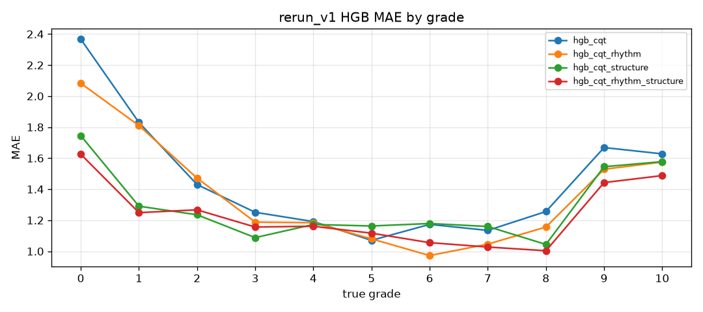
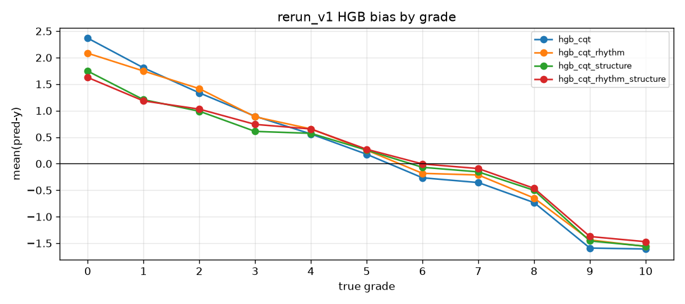

# 逐曲错误案例分析（rerun_v1 validation）

仅 validation；未评估 test。人工试听已完成（15 首去重案例）；下列归纳为**探索性个案**，不能外推为全体机制证明。

## 1. 整体等级统计

### 1.1 HGB 分等级 MAE / bias

### 1.2 等级带汇总（HGB）

| model | band | n | MAE | bias | acc±1 |
| --- | --- | --- | --- | --- | --- |
| hgb_cqt | Low0-3 | 481 | 1.547 | +1.386 | 0.374 |
| hgb_cqt | Mid4-6 | 607 | 1.149 | +0.172 | 0.522 |
| hgb_cqt | High7-10 | 952 | 1.437 | -1.117 | 0.454 |
| hgb_cqt_rhythm | Low0-3 | 481 | 1.511 | +1.367 | 0.395 |
| hgb_cqt_rhythm | Mid4-6 | 607 | 1.083 | +0.258 | 0.555 |
| hgb_cqt_rhythm | High7-10 | 952 | 1.349 | -1.019 | 0.449 |
| hgb_cqt_structure | Low0-3 | 481 | 1.233 | +0.968 | 0.507 |
| hgb_cqt_structure | Mid4-6 | 607 | 1.172 | +0.265 | 0.484 |
| hgb_cqt_structure | High7-10 | 952 | 1.354 | -0.974 | 0.472 |
| hgb_cqt_rhythm_structure | Low0-3 | 481 | 1.246 | +1.011 | 0.505 |
| hgb_cqt_rhythm_structure | Mid4-6 | 607 | 1.113 | +0.321 | 0.512 |
| hgb_cqt_rhythm_structure | High7-10 | 952 | 1.263 | -0.905 | 0.496 |

### 1.3 简要结论

- 基线 `hgb_cqt` 整体 MAE=1.377，bias=-0.143。
- 分带 MAE：Low 1.547 / Mid 1.149 / High 1.437。
- 分带 bias：Low +1.386 / Mid +0.172 / High -1.117 （正=高估，负=低估）。
- 全加 `hgb_cqt_rhythm_structure` High MAE 1.263，bias -0.905。
- 若 Low 正 bias、High 负 bias，则为向中间收缩的等级偏好。

## 2. 筛选案例

筛选规则见 `../PLAN.md`；本报告共 15 首（类别间去重后）。

- 类别：`baseline_large_err`；真值 **10**（High7-10）
- 时长：CQT=52.8s；meta_duration=700.28；MP3=53.0s；边界=start_end [10.0,63.0] len=53.0s；对齐风险=否

| experiment | pred | err |
| --- | --- | --- |
| hgb_cqt | 1.846 | -8.154 |
| hgb_cqt_rhythm | 1.500 | -8.500 |
| hgb_cqt_structure | 2.000 | -8.000 |
| hgb_cqt_rhythm_structure | 1.855 | -8.145 |
| early_cqt | 2.412 | -7.588 |
| early_cqt_rhythm | 0.828 | -9.172 |
| late_cqt | 1.123 | -8.877 |
| late_rhythm | 1.240 | -8.760 |
| late_combined | 2.053 | -7.947 |

- 人工试听：`done`
- 假设原因：The full track is approximately 12 minutes long, but only the first 53 seconds were extracted for the CQT and MP3 files—likely due to an extraction error—which has resulted in very low prediction scores.

### Carter-Varney G.The Artamidae

- 类别：`baseline_large_err`；真值 **8**（High7-10）
- 时长：CQT=16.0s；meta_duration=988.24；MP3=16.0s；边界=start_end [142.0,158.0] len=16.0s；对齐风险=否

| experiment | pred | err |
| --- | --- | --- |
| hgb_cqt | 1.453 | -6.547 |
| hgb_cqt_rhythm | 2.100 | -5.900 |
| hgb_cqt_structure | 1.805 | -6.195 |
| hgb_cqt_rhythm_structure | 1.512 | -6.488 |
| early_cqt | 1.445 | -6.555 |
| early_cqt_rhythm | 1.125 | -6.875 |
| late_cqt | 1.489 | -6.511 |
| late_rhythm | 3.334 | -4.666 |
| late_combined | 4.238 | -3.762 |

- 人工试听：`done`
- 假设原因：The entire track is approximately 16 minutes long, but the CQT and MP3 files only contain a 16-second segment from the middle—likely due to an extraction error—which has resulted in very low prediction scores.

### Hindemith P.Ludus Tonalis - Fuga octava in D major and Interludium allegro molto

- 类别：`baseline_large_err`；真值 **10**（High7-10）
- 时长：CQT=59.8s；meta_duration=3132.48；MP3=60.0s；边界=start_end [1880.0,1940.0] len=60.0s；对齐风险=否

| experiment | pred | err |
| --- | --- | --- |
| hgb_cqt | 3.491 | -6.509 |
| hgb_cqt_rhythm | 4.294 | -5.706 |
| hgb_cqt_structure | 3.998 | -6.002 |
| hgb_cqt_rhythm_structure | 4.999 | -5.001 |
| early_cqt | 5.406 | -4.594 |
| early_cqt_rhythm | 4.379 | -5.621 |
| late_cqt | 4.887 | -5.113 |
| late_rhythm | 8.148 | -1.852 |
| late_combined | 5.484 | -4.516 |

- 人工试听：`done`
- 假设原因：Only short segments of the samples are used. The CQT-based predictions are on the lower side, with only the rhythm predictions showing reasonable accuracy.

### Czerny C.Study in C major Op 553 No 1

- 类别：`baseline_large_err`；真值 **9**（High7-10）
- 时长：CQT=52.4s；meta_duration=51.8；MP3=52.5s；边界=无；对齐风险=否

| experiment | pred | err |
| --- | --- | --- |
| hgb_cqt | 2.605 | -6.395 |
| hgb_cqt_rhythm | 3.434 | -5.566 |
| hgb_cqt_structure | 3.515 | -5.485 |
| hgb_cqt_rhythm_structure | 3.265 | -5.735 |
| early_cqt | 4.500 | -4.500 |
| early_cqt_rhythm | 3.545 | -5.455 |
| late_cqt | 3.652 | -5.348 |
| late_rhythm | 4.523 | -4.477 |
| late_combined | 2.141 | -6.859 |

- 人工试听：`done`
- 假设原因：The model may have incorrectly assessed the difficulty based on duration.

### Villa-Lobos H.O Polichinello No 7 from Prole do bebe Volume 1

- 类别：`structure_improved`；真值 **9**（High7-10）
- 时长：CQT=53.8s；meta_duration=737.36；MP3=54.0s；边界=start_end [685.0,739.0] len=54.0s；对齐风险=否

| experiment | pred | err |
| --- | --- | --- |
| hgb_cqt | 2.994 | -6.006 |
| hgb_cqt_rhythm | 4.384 | -4.616 |
| hgb_cqt_structure | 7.550 | -1.450 |
| hgb_cqt_rhythm_structure | 7.864 | -1.136 |
| early_cqt | 8.625 | -0.375 |
| early_cqt_rhythm | 7.207 | -1.793 |
| late_cqt | 6.211 | -2.789 |
| late_rhythm | 8.039 | -0.961 |
| late_combined | 9.070 | +0.070 |

- 人工试听：`done`
- 假设原因：Although this piece is also an excerpt taken from a longer work, it sounds noticeably difficult; it features a high degree of structural repetition and a very fast tempo.

### Rollin C.Bank of the Oise at Auvers

- 类别：`structure_improved`；真值 **3**（Low0-3）
- 时长：CQT=69.8s；meta_duration=None；MP3=69.9s；边界=无；对齐风险=否

| experiment | pred | err |
| --- | --- | --- |
| hgb_cqt | 6.792 | +3.792 |
| hgb_cqt_rhythm | 6.839 | +3.839 |
| hgb_cqt_structure | 3.064 | +0.064 |
| hgb_cqt_rhythm_structure | 4.253 | +1.253 |
| early_cqt | 4.004 | +1.004 |
| early_cqt_rhythm | 5.945 | +2.945 |
| late_cqt | 4.492 | +1.492 |
| late_rhythm | 8.102 | +5.102 |
| late_combined | 4.422 | +1.422 |

- 人工试听：`done`
- 假设原因：The repetitions and segments within the tracks are clearly defined, with structural characteristics that are highly distinct. Relying solely on CQT or rhythmic features yields less effective results.

### Handel G.Fugue in F major HWV 611

- 类别：`structure_improved`；真值 **8**（High7-10）
- 时长：CQT=181.2s；meta_duration=183.56；MP3=181.3s；边界=无；对齐风险=否

| experiment | pred | err |
| --- | --- | --- |
| hgb_cqt | 3.632 | -4.368 |
| hgb_cqt_rhythm | 3.271 | -4.729 |
| hgb_cqt_structure | 6.767 | -1.233 |
| hgb_cqt_rhythm_structure | 6.599 | -1.401 |
| early_cqt | 5.285 | -2.715 |
| early_cqt_rhythm | 5.684 | -2.316 |
| late_cqt | 5.680 | -2.320 |
| late_rhythm | 5.516 | -2.484 |
| late_combined | 4.961 | -3.039 |

- 人工试听：`done`
- 假设原因：The repetitions and segments within the tracks are clearly defined, with structural characteristics that are with lowest error. Relying solely on CQT or rhythmic features yields less effective results.

### Bailey K.Scoobie du wup

- 类别：`structure_worsened`；真值 **1**（Low0-3）
- 时长：CQT=313.6s；meta_duration=313.52；MP3=313.7s；边界=无；对齐风险=否

| experiment | pred | err |
| --- | --- | --- |
| hgb_cqt | 4.530 | +3.530 |
| hgb_cqt_rhythm | 5.313 | +4.313 |
| hgb_cqt_structure | 8.326 | +7.326 |
| hgb_cqt_rhythm_structure | 7.265 | +6.265 |
| early_cqt | 5.395 | +4.395 |
| early_cqt_rhythm | 5.148 | +4.148 |
| late_cqt | 6.113 | +5.113 |
| late_rhythm | 6.445 | +5.445 |
| late_combined | 7.047 | +6.047 |

- 人工试听：`done`
- 假设原因：This track is a tutorial. It features spoken instruction throughout, with the complete piece included in the final minute; however, the metadata lacks appropriate segment markers.

### Liszt F.Marche funebre in F minor no 6 S163

- 类别：`structure_worsened`；真值 **9**（High7-10）
- 时长：CQT=350.6s；meta_duration=357.32；MP3=350.7s；边界=only_start [7.0,357.3] len=350.3s；对齐风险=否

| experiment | pred | err |
| --- | --- | --- |
| hgb_cqt | 8.505 | -0.495 |
| hgb_cqt_rhythm | 6.237 | -2.763 |
| hgb_cqt_structure | 5.798 | -3.202 |
| hgb_cqt_rhythm_structure | 5.505 | -3.495 |
| early_cqt | 9.406 | +0.406 |
| early_cqt_rhythm | 8.641 | -0.359 |
| late_cqt | 8.742 | -0.258 |
| late_rhythm | 5.633 | -3.367 |
| late_combined | 7.375 | -1.625 |

- 人工试听：`done`
- 假设原因：CQT alone yields excellent predictive results. The piece’s overall tempo is not particularly fast; its difficulty stems primarily from the high number of chords and a lack of structural repetition.

### Ravel M.Prelude (1913)

- 类别：`structure_worsened`；真值 **7**（High7-10）
- 时长：CQT=74.4s；meta_duration=None；MP3=74.6s；边界=无；对齐风险=否

| experiment | pred | err |
| --- | --- | --- |
| hgb_cqt | 6.632 | -0.368 |
| hgb_cqt_rhythm | 6.009 | -0.991 |
| hgb_cqt_structure | 3.933 | -3.067 |
| hgb_cqt_rhythm_structure | 4.271 | -2.729 |
| early_cqt | 5.344 | -1.656 |
| early_cqt_rhythm | 4.469 | -2.531 |
| late_cqt | 4.770 | -2.230 |
| late_rhythm | 6.371 | -0.629 |
| late_combined | 6.660 | -0.340 |

- 人工试听：`done`
- 假设原因：The structure lacks strong repetition, which doesn't sound too difficult.

### Liszt F.Album Leaf S 166g - Serenade

- 类别：`rhythm_improved`；真值 **5**（Mid4-6）
- 时长：CQT=15.8s；meta_duration=11.8；MP3=15.9s；边界=无；对齐风险=否

| experiment | pred | err |
| --- | --- | --- |
| hgb_cqt | 0.685 | -4.315 |
| hgb_cqt_rhythm | 3.614 | -1.386 |
| hgb_cqt_structure | 3.236 | -1.764 |
| hgb_cqt_rhythm_structure | 3.579 | -1.421 |
| early_cqt | 3.986 | -1.014 |
| early_cqt_rhythm | 1.809 | -3.191 |
| late_cqt | 1.057 | -3.943 |
| late_rhythm | 1.383 | -3.617 |
| late_combined | 1.360 | -3.640 |

- 人工试听：`done`
- 假设原因：The piece is too short.

### Stockhausen K.Klavierstucke V

- 类别：`rhythm_improved`；真值 **10**（High7-10）
- 时长：CQT=321.2s；meta_duration=312.16；MP3=321.3s；边界=only_start [8.0,312.2] len=304.2s；对齐风险=否

| experiment | pred | err |
| --- | --- | --- |
| hgb_cqt | 5.799 | -4.201 |
| hgb_cqt_rhythm | 8.027 | -1.973 |
| hgb_cqt_structure | 6.051 | -3.949 |
| hgb_cqt_rhythm_structure | 6.819 | -3.181 |
| early_cqt | 6.723 | -3.277 |
| early_cqt_rhythm | 6.934 | -3.066 |
| late_cqt | 8.242 | -1.758 |
| late_rhythm | 8.453 | -1.547 |
| late_combined | 6.723 | -3.277 |

- 人工试听：`done`
- 假设原因：Both the `late_cqt` and `late_rhythm` predictions are quite accurate, but `late_combined` performs significantly worse. The overall tempo is not particularly fast, and there is little structural repetition.

### Scriabin A.Prelude - op 11 no 17 Ab major

- 类别：`rhythm_improved`；真值 **8**（High7-10）
- 时长：CQT=44.0s；meta_duration=1982.48；MP3=44.0s；边界=start_end [1478.0,1522.0] len=44.0s；对齐风险=否

| experiment | pred | err |
| --- | --- | --- |
| hgb_cqt | 4.637 | -3.363 |
| hgb_cqt_rhythm | 6.804 | -1.196 |
| hgb_cqt_structure | 5.299 | -2.701 |
| hgb_cqt_rhythm_structure | 7.016 | -0.984 |
| early_cqt | 3.709 | -4.291 |
| early_cqt_rhythm | 6.168 | -1.832 |
| late_cqt | 2.113 | -5.887 |
| late_rhythm | 4.852 | -3.148 |
| late_combined | 3.656 | -4.344 |

- 人工试听：`done`
- 假设原因：The latter part is fast-paced and has a strong rhythm.

### Tan C.The Wind from A Childs Garden of Verses

- 类别：`rhythm_worsened`；真值 **2**（Low0-3）
- 时长：CQT=44.2s；meta_duration=41.52；MP3=44.3s；边界=无；对齐风险=否

| experiment | pred | err |
| --- | --- | --- |
| hgb_cqt | 2.261 | +0.261 |
| hgb_cqt_rhythm | 4.413 | +2.413 |
| hgb_cqt_structure | 1.969 | -0.031 |
| hgb_cqt_rhythm_structure | 3.344 | +1.344 |
| early_cqt | 2.014 | +0.014 |
| early_cqt_rhythm | 2.502 | +0.502 |
| late_cqt | 3.742 | +1.742 |
| late_rhythm | 6.086 | +4.086 |
| late_combined | 1.424 | -0.576 |

- 人工试听：`done`
- 假设原因：There are some fast-paced connected notes (legato/slur sequences), but the actual difficulty level is only 2.

### Dvorak A.Polka in E major B 3

- 类别：`rhythm_worsened`；真值 **8**（High7-10）
- 时长：CQT=137.2s；meta_duration=129.12；MP3=137.3s；边界=无；对齐风险=否

| experiment | pred | err |
| --- | --- | --- |
| hgb_cqt | 8.083 | +0.083 |
| hgb_cqt_rhythm | 5.975 | -2.025 |
| hgb_cqt_structure | 7.882 | -0.118 |
| hgb_cqt_rhythm_structure | 7.062 | -0.938 |
| early_cqt | 8.148 | +0.148 |
| early_cqt_rhythm | 5.797 | -2.203 |
| late_cqt | 8.992 | +0.992 |
| late_rhythm | 4.883 | -3.117 |
| late_combined | 7.160 | -0.840 |

- 人工试听：`done`
- 假设原因：Features rapid, connected notes and a lively rhythm, though the rhythmic characteristics are not well predicted.

## 3. 小结（人工核验后）

试听完成后，大误差与特征增益/损害可归为四类（一首可兼属多类）。定量主结果仍以 `../summaries/RESULTS.md` 为准；此处只解释典型失败与个案。

### 3.1 数据 / 切片问题（先于模型）

多首“基线灾难误差”首先是**输入不是完整教学曲目**：

- **Copland / Carter-Varney**：meta 时长达十余分钟，但 CQT/MP3 仅约 53s / 16s 片段；全体模型严重低估（真值 10/8，预测约 1–4）。
- **Hindemith**：从极长录音中切出约 60s；CQT 系偏低，节奏分支相对更接近。
- **Bailey**：整轨为**教程**（大量讲解，完整演奏靠后），缺合适分段；加结构后误差进一步变差。
- **Scriabin**：同样是长录音中的短切片（约 44s），但仍可听出后段快、节奏强——说明切片有时仍保留局部可预测线索。

报告含义：部分 `|err|≥5` 应标为 **content mismatch / segmentation**，不宜直接写成“谱面难度特征失败”。

### 3.2 结构特征：何时帮、何时害

**改善（与听感一致的方向）：**

- **Villa-Lobos**：摘录仍听感很难，重复多、速度快；加 structure 后从 ~3 拉到 ~7.5–7.9（真值 9）。
- **Rollin / Handel**：段落与重复清晰；仅靠 CQT/节奏易偏，加 structure 后最接近真值。

**变差或无益：**

- **Liszt Marche funebre**：CQT-only 已很好（约 8.5≈9）；难度更在和弦密度而非结构重复，加 structure/rhythm 反而拉低。
- **Ravel Prelude**：听感重复不强；加 structure 明显低估。
- **Bailey**：内容类型问题（教程）叠加结构统计，恶化最大。

报告含义：chroma-SSM 统计在**重复/分段鲜明**时有用；难度主因是织体/和声、或音频不是纯演奏时，结构项可能注入噪声。与全体 HGB 上 structure 仍有小幅 lift 不矛盾——个案说明边界条件。

### 3.3 节奏特征：局部有用，易与“教学难度”错位

**改善：**

- **Scriabin**：后段快、节奏突出，加 rhythm 误差明显下降。
- **Stockhausen**：HGB 加 rhythm 有帮助；听感上整体并不算“特别快”、重复也少——说明节奏向量抓到的不全是速度标签。`late_cqt`/`late_rhythm` 各自尚可，但 `late_combined` 变差，提示融合不稳定。
- **Album Leaf**：曲极短，加 rhythm 数字上变好，但短时窗使结论脆弱。

**变差：**

- **Tan**：有快速连奏，真值仅 2；节奏特征易**把活跃度当成难度**而高估。
- **Dvorak Polka**：听感活、有连奏，但加 rhythm 后预测偏低——节奏描述子与该曲教学难度不对齐。

报告含义：onset/tempo 类特征与 syllabus 难度相关但不等价；“快/连”既可能抬高也可能干扰。

### 3.4 等级偏好与方法选择

§1 分带 bias（Low 高估、High 低估）与个案一致：极端高等级若再叠加短切片，会被系统性压向中间。Czerny 等曲在时长正常时仍被低估，说明除数据问题外，**谱面技术难度**（触键、指法密度等）未被当前音频特征充分覆盖。

**可写进正文的谨慎结论：**

1. 最大误差中有可识别的**数据切片/非演奏内容**污染。  
2. 结构特征在重复清晰的个案上与听感一致；在弱重复或 CQT 已足够时可能有害。  
3. 节奏特征改善不稳定，且易与表面活跃度混淆。  
4. 全加 HGB 在 validation 上最优（见 summaries），但个案显示增益来源异质，不能归因于单一音乐机制。

### 3.5 各类入选（含与他类重复前）

- `baseline_large_err` (4)：Copland A.Piano Variations; Carter-Varney G.The Artamidae; Hindemith P.Ludus Tonalis - Fuga octava in D major and Interludium allegro molto; Czerny C.Study in C major Op 553 No 1
- `structure_improved` (3)：Villa-Lobos H.O Polichinello No 7 from Prole do bebe Volume 1; Rollin C.Bank of the Oise at Auvers; Handel G.Fugue in F major HWV 611
- `structure_worsened` (3)：Bailey K.Scoobie du wup; Liszt F.Marche funebre in F minor no 6 S163; Ravel M.Prelude (1913)
- `rhythm_improved` (3)：Liszt F.Album Leaf S 166g - Serenade; Stockhausen K.Klavierstucke V; Scriabin A.Prelude - op 11 no 17 Ab major
- `rhythm_worsened` (3)：Liszt F.Marche funebre in F minor no 6 S163; Tan C.The Wind from A Childs Garden of Verses; Dvorak A.Polka in E major B 3
- `full_still_bad` (3)：Copland A.Piano Variations; Carter-Varney G.The Artamidae; Bailey K.Scoobie du wup
