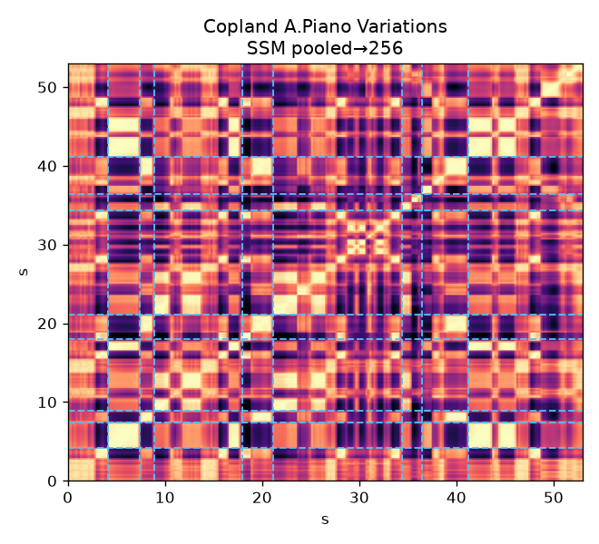
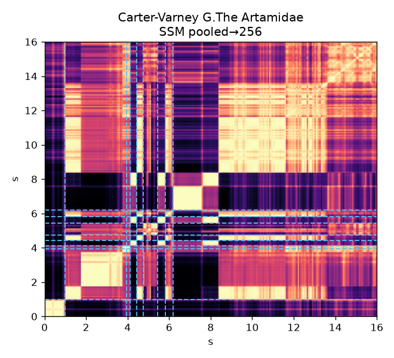
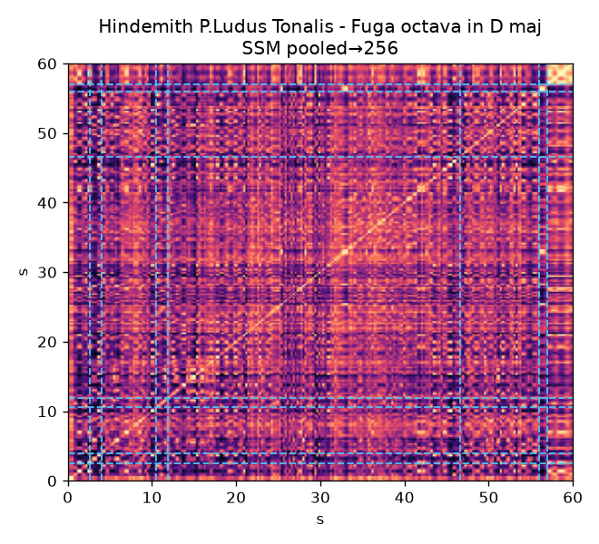
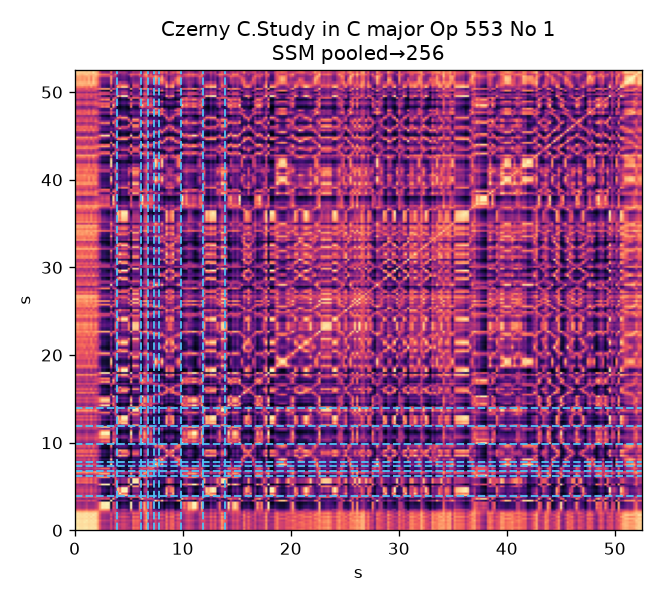
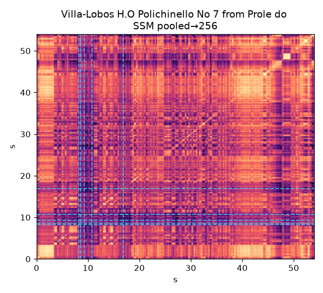
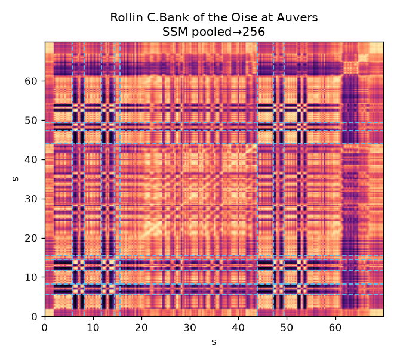
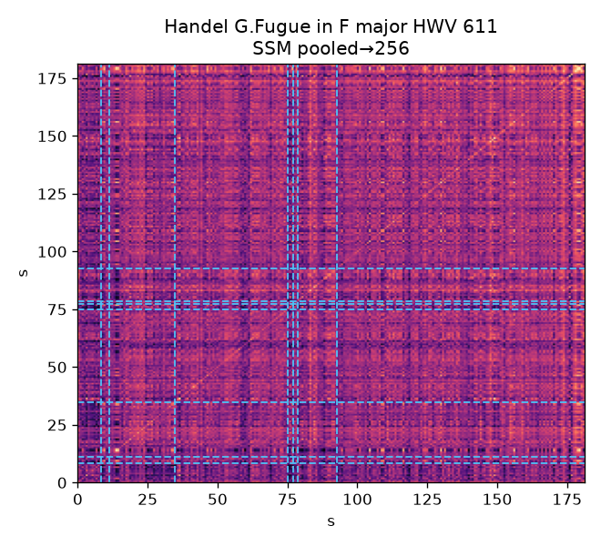
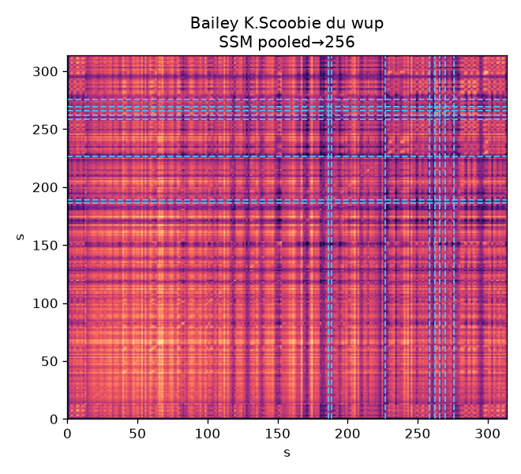
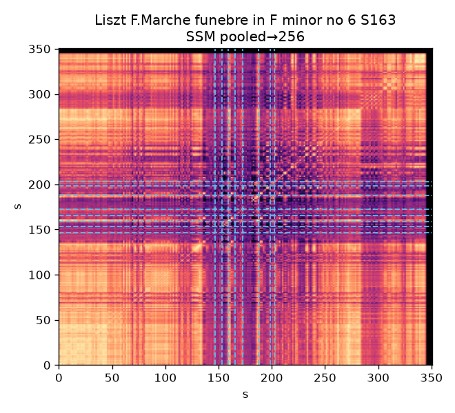
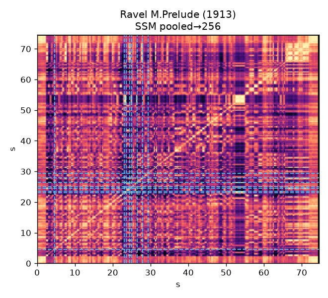

# SSM 音乐实例核验（rerun_v1 validation）

蓝色虚线为 novelty 峰（现有启发式，**非完整 Foote**）。
时间轴相对当前 MP3。共 **10** 首 validation **错误预测**曲目。
图题曲名 = `case.json` id = 小节标题；`repeat_*.wav` 从同名 MP3 切片。
图片为 `*_v3.png`（novelty 蓝虚线 `lw=1.2`）。`verdict` 主要评价**自动相似段**；整图结构另见说明。

## 1. Copland A.Piano Variations

真值 10；HGB：hgb_cqt=1.85, hgb_cqt_rhythm=1.50, hgb_cqt_structure=2.00, hgb_cqt_rhythm_structure=1.86
时长：CQT=52.8s，MP3=53.0s，meta_duration=700.28；对齐风险=否
**不是完整曲**：YT *Copland - Piano Variations (1930)* 约 12 分钟，本地仅 53s 摘录。
状态：`ok`。自动相似段 [5.4-13.5s] vs [17.6-25.7s]，sim=1.000

候选重复：[repeat_1](case_01/repeat_1.wav) / [repeat_2](case_01/repeat_2.wav)

人工核验：`listening=done`，`verdict=partial`

## 2. Carter-Varney G.The Artamidae

真值 8；HGB：hgb_cqt=1.45, hgb_cqt_rhythm=2.10, hgb_cqt_structure=1.81, hgb_cqt_rhythm_structure=1.51
时长：CQT=16.0s，MP3=16.0s，meta_duration=988.24；对齐风险=否
状态：`ok`。自动相似段 [0.0-5.7s] vs [4.7-12.8s]，sim=1.000

候选重复：[repeat_1](case_02/repeat_1.wav) / [repeat_2](case_02/repeat_2.wav)

人工核验：`listening=done`，`verdict=partial`

## 3. Hindemith P.Ludus Tonalis - Fuga octava in D major and Interludium allegro molto

真值 10；HGB：hgb_cqt=3.49, hgb_cqt_rhythm=4.29, hgb_cqt_structure=4.00, hgb_cqt_rhythm_structure=5.00
时长：CQT=59.8s，MP3=60.0s，meta_duration=3132.48；对齐风险=否
状态：`ok`。自动相似段 [9.6-17.8s] vs [17.1-25.3s]，sim=0.991

候选重复：[repeat_1](case_03/repeat_1.wav) / [repeat_2](case_03/repeat_2.wav)

人工核验：`listening=done`，`verdict=confirmed`

## 4. Czerny C.Study in C major Op 553 No 1

真值 9；HGB：hgb_cqt=2.60, hgb_cqt_rhythm=3.43, hgb_cqt_structure=3.52, hgb_cqt_rhythm_structure=3.27
时长：CQT=52.4s，MP3=52.5s，meta_duration=51.8；对齐风险=否
状态：`ok`。自动相似段 [5.9-14.0s] vs [34.1-42.1s]，sim=0.989

候选重复：[repeat_1](case_04/repeat_1.wav) / [repeat_2](case_04/repeat_2.wav)

人工核验：`listening=done`，`verdict=confirmed`

## 5. Villa-Lobos H.O Polichinello No 7 from Prole do bebe Volume 1

真值 9；HGB：hgb_cqt=2.99, hgb_cqt_rhythm=4.38, hgb_cqt_structure=7.55, hgb_cqt_rhythm_structure=7.86
时长：CQT=53.8s，MP3=54.0s，meta_duration=737.36；对齐风险=否
状态：`ok`。自动相似段 [0.0-6.1s] vs [36.5-44.7s]，sim=0.957

候选重复：[repeat_1](case_05/repeat_1.wav) / [repeat_2](case_05/repeat_2.wav)

人工核验：`listening=done`，`verdict=partial`

## 6. Rollin C.Bank of the Oise at Auvers

真值 3；HGB：hgb_cqt=6.79, hgb_cqt_rhythm=6.84, hgb_cqt_structure=3.06, hgb_cqt_rhythm_structure=4.25
时长：CQT=69.8s，MP3=69.9s，meta_duration=None；对齐风险=否
状态：`ok`。自动相似段 [0.0-6.3s] vs [39.9-48.3s]，sim=0.998

候选重复：[repeat_1](case_06/repeat_1.wav) / [repeat_2](case_06/repeat_2.wav)

人工核验：`listening=done`，`verdict=confirmed`

## 7. Handel G.Fugue in F major HWV 611

真值 8；HGB：hgb_cqt=3.63, hgb_cqt_rhythm=3.27, hgb_cqt_structure=6.77, hgb_cqt_rhythm_structure=6.60
时长：CQT=181.2s，MP3=181.3s，meta_duration=183.56；对齐风险=否
状态：`ok`。自动相似段 [9.2-18.4s] vs [174.9-181.3s]，sim=0.941

候选重复：[repeat_1](case_07/repeat_1.wav) / [repeat_2](case_07/repeat_2.wav)

人工核验：`listening=done`，`verdict=rejected`
说明：整曲 SSM 织体偏均匀/自相似，但自动两段（开头 vs 曲尾）听感不像同一材料；赋格织体 ≠ 成对乐句。

## 8. Bailey K.Scoobie du wup

真值 1；HGB：hgb_cqt=4.53, hgb_cqt_rhythm=5.31, hgb_cqt_structure=8.33, hgb_cqt_rhythm_structure=7.26
时长：CQT=313.6s，MP3=313.7s，meta_duration=313.52；对齐风险=否
状态：`ok`。自动相似段 [63.7-72.3s] vs [170.3-178.9s]，sim=0.963

候选重复：[repeat_1](case_08/repeat_1.wav) / [repeat_2](case_08/repeat_2.wav)

人工核验：`listening=done`，`verdict=rejected`

## 9. Liszt F.Marche funebre in F minor no 6 S163

真值 9；HGB：hgb_cqt=8.51, hgb_cqt_rhythm=6.24, hgb_cqt_structure=5.80, hgb_cqt_rhythm_structure=5.51
时长：CQT=350.6s，MP3=350.7s，meta_duration=357.32；对齐风险=否
状态：`ok`。自动相似段 [131.5-141.1s] vs [184.9-194.5s]，sim=0.997

候选重复：[repeat_1](case_09/repeat_1.wav) / [repeat_2](case_09/repeat_2.wav)

人工核验：`listening=done`，`verdict=confirmed`

## 10. Ravel M.Prelude (1913)

真值 7；HGB：hgb_cqt=6.63, hgb_cqt_rhythm=6.01, hgb_cqt_structure=3.93, hgb_cqt_rhythm_structure=4.27
时长：CQT=74.4s，MP3=74.6s，meta_duration=None；对齐风险=否
状态：`ok`。自动相似段 [0.0-7.0s] vs [20.4-28.8s]，sim=0.999

候选重复：[repeat_1](case_10/repeat_1.wav) / [repeat_2](case_10/repeat_2.wav)

人工核验：`listening=done`，`verdict=partial`
（正文原为 pending；收束为 partial。若你的判定不同请改回。）

## 11. 小结与结论

### 11.1 听辨汇总

| # | 案例 | 自动段 verdict | 要点 |
| --- | --- | --- | --- |
| 1 | Copland | partial | 53s 摘录；局部像，解释不了真值 10 |
| 2 | Carter-Varney | partial | 16s 切片；自动段部分像 |
| 3 | Hindemith | confirmed | 自动段成立；仍是长录音短切片 |
| 4 | Czerny | confirmed | 自动段成立；完整时长仍被严重低估 |
| 5 | Villa-Lobos | partial | 段部分像；加结构后预测明显改善 |
| 6 | Rollin | confirmed | 重复清晰；加结构纠偏最干净 |
| 7 | Handel | rejected | 整图自相似，自动窗（头 vs 尾）不像 |
| 8 | Bailey | rejected | 教程音；自动相似不成立 |
| 9 | Liszt Marche | confirmed | 段像，但难度不靠重复；加结构反而变差 |
| 10 | Ravel | partial | 结构重复不强；与加结构变差一致 |

计数：**confirmed 4 / partial 4 / rejected 2**。

### 11.2 读图分析（按 SSM 外观，不依赖自动窗）

读图约定：对角亮块≈段落同质；离对角平行亮带≈材料再现；大面积均匀细纹理≈全程织体相近；novelty 蓝虚线=启发式边界（可密报）。

| # | 曲目 | 图上结构印象 | 与误差/结构特征的联系 |
| --- | --- | --- | --- |
| 1 | Copland（~53s） | 对角多块 + 明显离对角条纹；novelty 很密 | **短摘录上结构仍“忙”**；不能代表完整 12 分钟变奏曲，却足以让模型看到局部组织 → 与全体低估并存 |
| 2 | Carter-Varney（16s） | 块状分明（含一段极亮同质块 ~6–8s）；离对角有相邻块相似 | **切片过短**，图上像“几小节拼盘”；结构统计噪声大，难对应真值 8 |
| 3 | Hindemith（60s） | 中段（~12–47s）密细平行对角纹；首尾有块 | **赋格式动机反复**在图上很清楚；自动段 confirmed 对齐；但仍是长录音短切 |
| 4 | Czerny（~52s） | 中后段网格纹理强；后部与前部有离对角呼应（再现感） | **练习曲式重复清晰且时长完整**；自动段 confirmed，但模型仍低估 → 难度可能在指法/速度，不只在“有没有重复” |
| 5 | Villa-Lobos（~54s） | 开头亮块 + 中段大量平行对角纹 + 尾部小亮块 | **重复/回响在图上可见**；与加 structure 后预测上升一致（partial） |
| 6 | Rollin（~70s） | **最清晰的块状分段**：约 0–16 / 16–44 / 44–62+；0–16 与 44–60 离对角很亮 | **教科书式 A–B–A′ 外观**；与 confirmed + 结构纠偏最干净一致 |
| 7 | Handel（~180s） | 全程密细平行纹、前半 novelty 多、后半更连续；**少见大块“再现方阵”** | **织体级自相似**（赋格），不是乐句级 ABA；解释“整图像、自动窗不像”与 rejected |
| 8 | Bailey（~314s） | 前半相对平；后段 novelty 扎堆；有离对角条但杂 | **长轨+非纯演奏（教程）**；图上结构信号乱，与 rejected、加结构变差一致 |
| 9 | Liszt（~350s） | **大块结构**：~0–140 同质橙块 → ~145–205 暗且 novelty 密 → ~205–285 再现亮块 → coda | **图上 ABA 很清楚**（confirmed）；但 CQT-only 已准、加结构变差 → 重复不等于难度 |
| 10 | Ravel（~75s） | 全程细碎网格；23–30s novelty 密；~53s 暗带（异质）；尾部亮块 | **动机碎、少大段再现**；与 partial、加结构变差相符 |

**读图分层（三类）：**

1. **块状清晰 / 再现明显**：Rollin、Liszt（图上最“像曲式”）；Czerny、Villa-Lobos 次之。  
2. **细纹密集、全程自相似**：Handel、Hindemith（赋格/对位织体）——结构特征易升高 recurrence，但不等于乐句重复。  
3. **切片或内容污染**：Copland、Carter-Varney、Bailey——图只反映当前短输入或杂音轨，解释力封顶。

### 11.3 归纳（听辨 + 读图）

1. **Rollin**：读图与听辨双重确认分段/再现；结构特征纠偏最可信。  
2. **Liszt**：读图也确认 ABA，但预测上 structure 有害 → **看见结构 ≠ 应对难度加分**。  
3. **Handel / Hindemith**：读图是织体级自相似；Handel 自动窗失败不否定整图有信息。  
4. **Bailey / 短切片三首**：图或听都受数据形态限制。  
5. **Czerny**：图上重复清楚、时长正常仍低估 → 结构之外还有缺口。  
6. **方法**：报告结构观察应以 **SSM 图为主**；自动窗为辅。

### 谨慎结论

与 error_cases §3.4 配套；定量主结果以 `../summaries/RESULTS.md` 为准。

1. **从图即可读出多种结构形态**（块状再现 / 赋格细纹 / 切片碎块），chroma-SSM 对错误案例并非空白。  
2. **与 HGB+structure 同向的个案**（尤其 Rollin，其次 Villa-Lobos）支持“结构统计有时抓住可听辨重复”。  
3. **反例必须保留**：Liszt（有结构但加特征变差）、Handel（织体像但非乐句对）、Bailey（内容类型错误）。  
4. **短摘录 SSM 只能解释当前输入**，不能写成完整作品曲式已验证。  
5. **因此**：structure 消融的 validation 增益只有**有限、情境性**支持；**不能**声称结构机制或 Foote 式段落检测已证实。

**表述限制：** novelty 非标准 Foote；读图为定性；meta 与 MP3 时长严重不符时只信当前音频与图上秒数。
