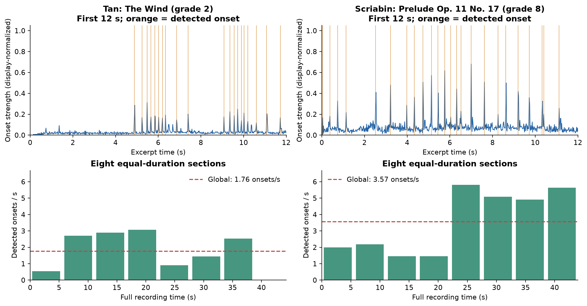
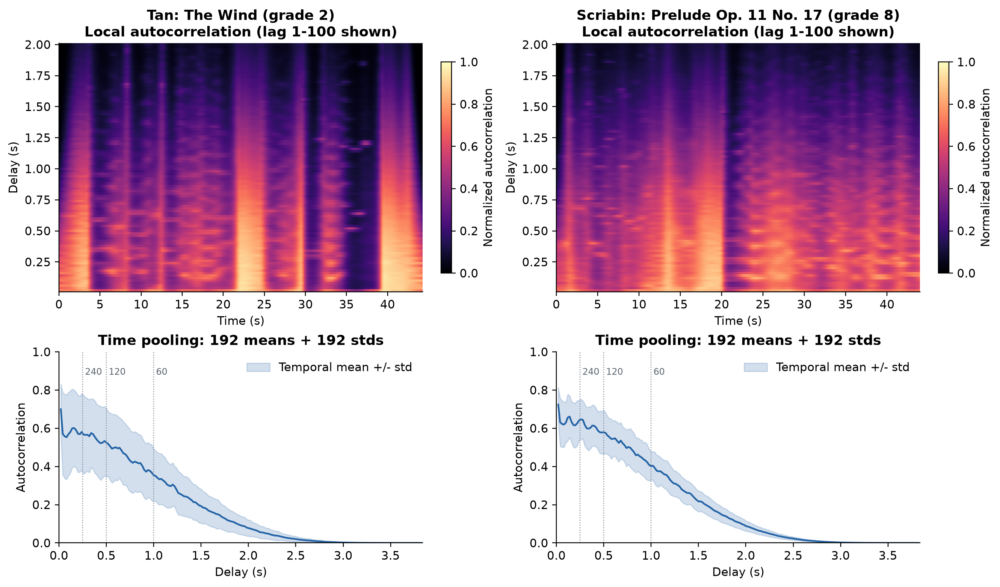
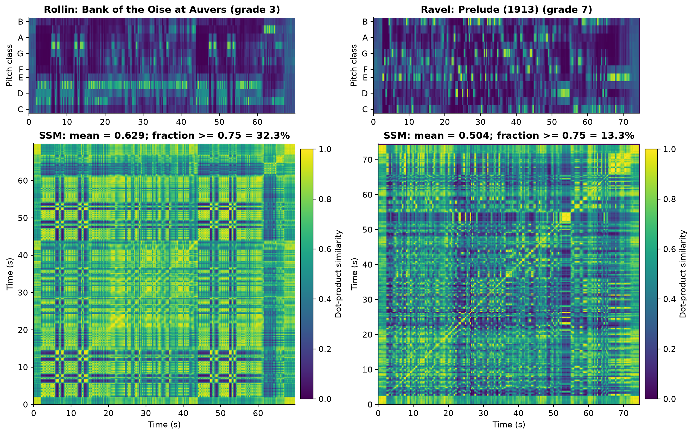
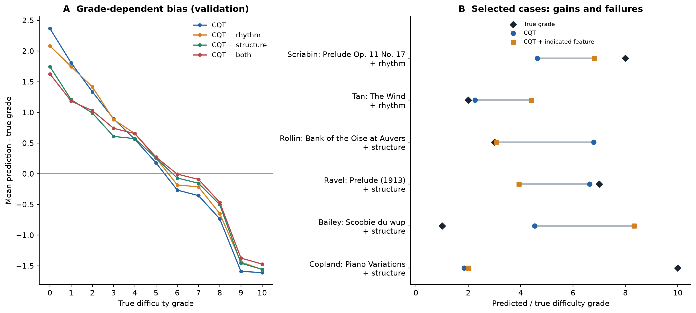

# 音频数据集准备、特征提取与错误分析

## 1. 音频数据集准备

PSyllabus 包含 7,901 条钢琴作品记录，提供曲目元数据、0–10 级难度标签及预计算 CQT。
曲目元数据记录了作曲家、曲名、YouTube 链接，以及部分作品在录音中的起止时间
（`start`、`end`、`only_start` 和 `only_end` 字段）。
由于部分链接指向多曲合集，或包含目标作品之外的内容，下载的完整音轨不能直接作为对应作品的输入。
本研究依据上述时间标注提取目标片段：同时提供起止时间时截取相应区间，仅提供一个端点时保留该端点至音轨边界的内容；
未提供时间标注时保留完整音轨。处理后的音频通过曲目标识与难度标签及 CQT 对齐。

音频与预计算 CQT 应覆盖相同的时间区间。根据音频采样点数和 CQT 帧数估计二者时长：

$$
T_{\mathrm{audio}}=\frac{N_{\mathrm{samples}}}{f_s},\qquad
T_{\mathrm{CQT}}\approx\frac{N_{\mathrm{frames}}}{5}.
$$

其中 fₛ 为音频采样率，CQT 的时间分辨率为 5 帧/秒。  
考虑帧量化和编码边界差异，采用 1 秒的绝对误差阈值。  
经音频下载与片段校正，共获得 7,703 首 MP3，其中 7,686 首满足时长阈值，占可用音频的 99.60%。  
其余 17 首保留时长异常标记，198 条记录未获得对应音频。

所有音频在特征提取前转换为单声道，保留原生采样率，并将波形峰值归一化至 0.99。
分析窗口按实际采样率换算，使不同录音具有一致的时间尺度。

## 2. 节奏特征提取

节奏特征描述演奏事件的密度、时间间隔及周期性。

### 2.1 起音密度与时间间隔

首先调用 `librosa.onset.onset_strength`，采用正向谱通量（positive spectral flux）方法，基于对数 Mel 功率谱提取起音强度包络，帧移设为 20 毫秒。核心计算为

$$
o(n)=\frac{1}{F}\sum_{m=1}^{F}\max\bigl(0,G(m,n)-G(m,n-1)\bigr),
$$

其中 G(m,n) 为第 n 帧、第 m 个 Mel 频带的对数功率，F 为频带数。
该式统计相邻帧中频谱能量的增加量。随后调用 `librosa.onset.onset_detect`，通过局部峰检测，结合自适应阈值及最小间隔约束确定起音时刻。

设录音时长为 T，检测到的起音次数为 N，则全曲起音密度定义为

$$
D=\frac{N}{T}.
$$

将录音划分为八个等时长区间，各区间的局部密度定义为

$$
D_b=\frac{N_b}{T/8},\qquad b=1,\ldots,8.
$$

其中 b 为区间编号，分子为该区间的起音次数，分母为区间时长。
全曲密度、八个区间密度及区间密度的标准差和最大值共构成 11 维特征，用于表征整体起音密集程度及局部疏密变化。

按时间顺序排列检测到的起音时刻，相邻起音时间间隔（inter-onset interval，IOI）定义为

$$
\Delta_i=t_{i+1}-t_i,\qquad i=1,\ldots,N-1.
$$

其中 tᵢ 为第 i 次起音的时刻。
对 IOI 序列计算均值、标准差、变异系数及第 25、50、75 百分位数，构成 6 维特征。
其中变异系数为标准差与均值之比，用于描述间隔相对于平均水平的离散程度。
此外，计算起音强度包络的均值、标准差、最大值及第 25、50、75、95 百分位数，构成 7 维起音强度特征。

**图 2.** 低难度曲目 Tan《The Wind》（2 级，左）与高难度曲目 Scriabin《Prelude Op. 11 No. 17》（8 级，右）的起音包络和八段起音密度。
上排展示开头 12 秒，各曲包络分别按最大值缩放，橙线表示检测到的起音；下排采用相同纵轴尺度，虚线表示全曲平均密度。

Scriabin 的平均起音密度为 3.57 次/秒，约为 Tan（1.76 次/秒）的两倍；
其中后半段密度为 4.91–5.82 次/秒，而 Tan 各区间的最高值为 3.07 次/秒。
Scriabin 的 IOI 中位数为 0.18 秒，低于 Tan 的 0.24 秒，即前者起音更密集，相邻起音的典型间隔也更短。
这一差异同时体现在全曲密度和分段统计中，说明所提取特征能够表征演奏事件的整体密集程度及局部变化。

### 2.2 局部周期性

为表征局部周期性，采用长度为 192 帧（3.84 秒）的 Hann 窗，以 1 帧（20 毫秒）的步长沿起音强度包络滑动。
调用 `librosa.feature.tempogram`，在每个窗口内对包络加权并计算自相关，将各窗口的结果按时间排列，构成 Tempogram：

$$
R_t(k)=\sum_n z_t(n)z_t(n-k),
$$

其中 zₜ 为以时刻 t 为中心的加窗包络，k 为延迟位置（lag）。
每个窗口的结果按最大自相关幅值归一化。包络帧移 Δt 为 0.02 秒，
第 k 个非零 lag 对应的延迟及重复速率为：

$$
\tau_k=k\Delta t,\qquad \mathrm{BPM}(k)=\frac{60}{k\Delta t},\qquad k>0.
$$

该速率可对应主拍、拍内细分或跨拍重复，并不唯一对应乐曲速度。  
沿时间轴对每个 lag 计算均值和标准差，分别描述周期性的平均强度及其变化，得到 384 维特征。  
此外，调用 `librosa.feature.tempo`，采用带速度先验的自相关峰选择方法估计全曲 BPM。周期集中度定义为 3.84 秒窗口 Tempogram 平均剖面的最大值与均值之比，计算范围包含零 lag 项。

**图 3.** 上排展示 lag 1–100 的局部自相关，下排展示非零 lag 的时间均值及均值±标准差。  
曲目及左右顺序同图 2，热图使用相同色标，实际特征计算范围为 lag 0–191。

热图中固定延迟处的高值表示：当前窗口内，起音强度包络与其延迟副本较为相似；
亮带沿时间延续，表示该时间尺度的周期性持续存在。下排曲线的均值反映这种相似性的整体水平，
阴影宽度反映其随时间的变化程度。

Tan 的局部自相关呈现较明显的强弱交替，Scriabin 的分布则更为连续。  
Tempogram 能补充描述活动的周期性如何随时间变化。  
周期性强弱或变化幅度均不具有直接的难度顺序，因而不能仅凭热图亮度或标准差判断难易。

下表汇总两部分特征的统计内容与维度。

| 特征组 | 统计内容 | 维度 |
| --- | --- | ---: |
| 起音密度 | 全曲、八段、分段标准差及最大值 | 11 |
| 起音强度 | 均值、标准差、最大值及 P25/P50/P75/P95 | 7 |
| IOI | 均值、标准差、变异系数及 P25/P50/P75 | 6 |
| 速度与周期集中度 | 估计 BPM、Tempogram 平均剖面最大值/均值 | 2 |
| Tempogram | 192 个 lag 的时间均值和标准差 | 384 |
| **合计** | | **410** |

上述五组统计共构成 410 维节奏向量。

## 3. 结构特征提取

结构特征基于录音中不同时刻的音级相似性，用于描述重复模式及内容变化。
首先调用 `librosa.feature.chroma_stft`，采用基于短时傅里叶变换（short-time Fourier transform，STFT）的 chroma 提取方法，
以 50 毫秒的帧移将功率谱映射为 12 维音级表示，合并不同八度的同名音。
逐帧 L2 归一化后，将时间轴均匀平均池化至最多 256 帧。
池化后的 chroma 矩阵由各时间区间的 12 维音级向量按列组成：

$$
\bar{C}=\begin{bmatrix}\bar{\mathbf{c}}_1 & \cdots & \bar{\mathbf{c}}_M\end{bmatrix}
\in\mathbb{R}^{12\times M},\qquad M\leq256.
$$

其中，M 为池化后的时间帧数，每列对应一个时间区间的音级向量。
自相似矩阵（self-similarity matrix，SSM）由池化向量的内积定义：

$$
S=\bar C^\top\bar C,\qquad S_{ij}=\bar{\mathbf c}_i^\top\bar{\mathbf c}_j.
$$

矩阵第 i 行、第 j 列的元素表示第 i 与第 j 个时间区间的音级相似程度。
非对角区域中的高值对应相隔一定时间的相似内容。池化后不再归一化，因此该相似度为内积。

整体相似性由上三角非对角元素的均值、标准差及高相似度元素比例概括。
其中，高相似度元素比例定义为

$$
r=\frac{2}{M(M-1)}\sum_{1\leq i<j\leq M}\mathbb{I}(S_{ij}\geq0.75),
$$

式中的指示函数在条件成立时取 1，否则取 0。
这三项统计共构成 3 维特征。

为描述不同时间间隔的相似性，沿 SSM 的第 ℓ 条上对角线计算均值，形成 lag 剖面：

$$
L(\ell)=\frac{1}{M-\ell}\sum_{i=1}^{M-\ell}S_{i,i+\ell},
\qquad \ell=1,\ldots,64,\quad \ell<M.
$$

当 ℓ ≥ M 时，对应值设为 0。64 个 lag 值及其均值、标准差和最大值共构成 67 维特征。
这里的 lag 以池化帧为单位，其对应的实际时间间隔随录音时长变化。

内容变化由相邻窗口间的交叉相似度构造。对于位置 i，两侧各取最多 8 个池化帧，左、右帧集合分别定义为

$$
A_i=\{a\in\mathbb{Z}:\max(1,i-8)\leq a<i\},\qquad
B_i=\{b\in\mathbb{Z}:i\leq b\leq\min(M,i+7)\}.
$$

先计算交叉相似度均值的负值，再平移至非负范围，得到 novelty 序列：

$$
q_i=-\frac{1}{|A_i||B_i|}\sum_{a\in A_i}\sum_{b\in B_i}S_{ab},
\qquad v_i=q_i-\min_{1\leq j\leq M}q_j.
$$

边界处使用可用帧；当任一集合为空时，将 qᵢ 设为 0。较大的 vᵢ 表示前后窗口的音级相似性较低。
对 novelty 序列计算均值和标准差，并将超过“均值加一个标准差”的严格局部极大值计为峰。
设峰数为 P、录音时长为 T，则峰密度为

$$
D_{\mathrm{novelty}}=\frac{P}{T}.
$$

novelty 均值、标准差和峰密度共构成 3 维特征，分别描述该变化指标的整体水平、波动程度及峰出现频率。
该指标仅衡量前后窗口的音级差异，峰检测未设置最小峰间距，同一变化区间的局部波动可能形成多个峰，因此峰数不直接对应音乐段落数。

**图 4.** 低难度曲目 Rollin《Bank of the Oise at Auvers》（3 级，左）与高难度曲目 Ravel《Prelude (1913)》（7 级，右）的池化 chroma（上排）和 SSM（下排）。两幅 SSM 使用相同色标。

Rollin 的 SSM 呈现较大范围的高相似度区域，非对角元素均值为 0.629，相似度不低于 0.75 的比例为 32.34%；
Ravel 的相应数值为 0.504 和 13.31%，图中高相似度区域更为局部化。
这些差异表明，结构特征能够区分两首曲目的音级相似性分布。

| 特征组 | 维度 |
| --- | ---: |
| SSM 非对角均值、标准差及重复比例 | 3 |
| novelty 均值、标准差及峰密度 | 3 |
| 1–64 lag 相似度 | 64 |
| lag 剖面均值、标准差及最大值 | 3 |
| **合计** | **73** |

## 4. 消融实验

为检验节奏与结构特征的独立贡献及联合效果，以 528 维 CQT 特征为基线设置四组实验。
所有实验使用同一版本的音频与特征，在共同可用的 7,686 条记录上进行比较。
划分同时约束作曲家与 YouTube 录音链接不跨集合，训练、验证和测试集分别为 4,089、2,040 和 1,557 条。

采用直方图梯度提升回归（HGB），固定学习率为 0.05、迭代次数为 300、随机种子为 42，
比较 7、15、31、63、127 个叶节点的候选模型。
根据验证集 Kendall’s Tau-c 选择模型，指标相同时采用较低 MSE。
以 Tau-c 衡量难度排序一致性，同时报告 MAE、MSE 及预测等级与真值相差不超过一级的准确率（Acc±1）。
Acc±1 使用裁剪至 0–10 后四舍五入的预测等级。以下均为验证集结果。

| 输入 | 总维度 | Tau-c ↑ | MAE ↓ | MSE ↓ | Acc±1 ↑ |
| --- | ---: | ---: | ---: | ---: | ---: |
| CQT | 528 | 0.6573 | 1.3772 | 3.1240 | 62.60% |
| CQT + 节奏 | 938 | 0.6801 | 1.3079 | 2.8363 | 66.32% |
| CQT + 结构 | 601 | 0.6840 | 1.2713 | 2.7369 | 67.16% |
| CQT + 节奏 + 结构 | 1011 | **0.7058** | **1.2143** | **2.4813** | **68.73%** |

加入节奏特征后，Tau-c 从 0.6573 提高至 0.6801；加入结构特征后提高至 0.6840。
联合使用两组特征取得最高 Tau-c（0.7058）及最低 MAE（1.2143），Acc±1 较基线提高 6.13 个百分点。
结果表明，两组统计特征包含 CQT 汇总表示未充分表达的信息，且联合使用优于任一单独特征组。

## 5. 错误案例分析

案例选择覆盖三类情况：基线绝对误差较大、加入节奏或结构后误差变化较大，以及联合模型仍明显误判。
对去重后的 15 首曲目进行人工试听分析，其中 10 首结合 SSM 检查相似片段。

**图 5.** 左图为分等级平均预测偏差，正值表示高估；右图比较六首案例的真值、基线及加入指定特征后的预测。
案例依据验证误差选取。

模型总体呈现向中间等级收缩的趋势。CQT 基线对 0–3 级曲目的平均偏差为 +1.386，
对 7–10 级为 −1.117；加入两组特征后，高等级偏差改善至 −0.905，但仍存在系统性低估。

| 曲目 | 真值 | CQT 预测 | 加入特征 | 加入后预测 |
| --- | ---: | ---: | --- | ---: |
| Scriabin, Prelude Op. 11 No. 17 | 8 | 4.64 | 节奏 | 6.80 |
| Tan, The Wind | 2 | 2.26 | 节奏 | 4.41 |
| Rollin, Bank of the Oise at Auvers | 3 | 6.79 | 结构 | 3.06 |
| Ravel, Prelude (1913) | 7 | 6.63 | 结构 | 3.93 |
| Bailey, Scoobie du wup | 1 | 4.53 | 结构 | 8.33 |
| Copland, Piano Variations | 10 | 1.85 | 结构 | 2.00 |

Scriabin 的预测在加入节奏后由 4.64 上升至 6.80，更接近真值 8；
Tan 的预测则由 2.26 上升至 4.41，偏离真值 2。试听中，Tan 同样包含较活跃的连续音型，但其教学等级较低。
当前节奏特征描述起音事件的密度、间隔和周期性，未直接刻画指法、手位移动及双手协调要求。
例如，固定手位内的快速重复与伴随大幅跳跃的连续音型可具有相近的起音密度和 IOI，但演奏要求存在差异；
同时发声的多个音也可能被合并为一次起音，因此起音密度不能直接代表音符数量或和弦复杂度。
此外，演奏速度和停顿会影响这些统计量，使其同时受到演奏版本的影响。
Tan 的案例说明，节奏活动较强并不必然对应较高技术难度，但尚不能据此确定预测高估由哪一项节奏特征造成。

加入结构特征后，Rollin 的预测由 6.79 降至 3.06，接近其真实等级 3；Ravel 的预测则由 6.63 降至 3.93，偏离其真实等级 7。
两首曲目的 SSM 分布存在差异，但加入结构特征后的预测均下降，说明这些结构统计对预测的影响并不总与真实难度一致。
当前结构特征描述音级内容的相似性及其时间分布，而演奏难度还涉及和弦跨度、声部协调和触键控制等技术要求。
例如，chroma 合并不同八度的同名音，使音区跨度不同的片段仍可能具有相近表示。
因此，结构特征可提供辅助信息，但不能替代对演奏技术的直接刻画；上述预测变化也不足以确定误判由哪一项结构统计造成。

另一些大误差与录音内容及标注范围有关。Bailey 的音频包含教程讲解，  
提取的统计量因而同时受到语言和演奏内容影响。Copland 的输入为元数据指定的 10–63 秒主题段，  
而全曲时长超过10分钟，因此难度标签对应的范围可能更广。该片段与 CQT 时长一致，但能否代表整部作品的技术要求尚不确定。  
这些案例表明，输入内容与难度标签的对应关系是解释预测误差的重要因素。

## 6. 本部分总结与局限性

本部分完成音频收集与片段整理，并提取了 410 维节奏特征和 73 维结构特征。
在相同 HGB 配置下，两组特征均改善 CQT 基线，联合使用获得最佳验证表现。
案例分析进一步识别了极端等级的系统性偏差，以及教程内容和短片段对预测的影响。

现有特征主要描述录音中的事件活动与音级关系，对钢琴演奏技术的刻画仍较间接。
起音检测可能将同时发声的多个音识别为单个事件，因此起音密度无法区分单音与和弦，也不能完整反映双手或多声部的协调要求。
节奏统计还受到演奏速度、停顿和起音检测误差的影响，相近的统计结果可能对应不同的指法与手位移动难度。
此外，全曲均值和标准差不保留事件顺序，持续时间较短的高难度片段可能在整体汇总中被稀释。

结构特征同样存在表示与分析尺度的限制。chroma 合并不同八度的同名音，因而无法直接表征音区跨度及跨音区跳跃。  
固定帧数池化使长曲目中每帧覆盖更长的时间，既可能平滑短时变化，也使相同 lag 在不同曲目中对应不同的实际时长。  
因此，这些统计量可描述音级分布及变化，但尚不能直接解释为乐句边界、曲式复杂度或演奏难度。

数据质量与标签范围也限制了结果解释。部分曲目包含教程人声讲解可能影响起音和音级统计，而部分曲目只进行短摘录，即使切片准确，也未必覆盖作品中决定其难度的段落。

实验结论目前基于单一固定划分，尚未检验性能提升在不同作曲家组合和样本划分下的稳定性。  

后续可首先核验录音内容、目标演奏区间与难度标签的对应范围，识别并排除教程中的语言片段，并检查短摘录能否覆盖主要技术难点。
在特征层面，可利用音符转录估计同时发声音符数、和弦跨度及声部运动，并通过保留八度信息的音高表示补充音域和跳跃特征。
这些估计应结合人工抽查评估转录误差，避免将检测偏差引入难度预测。
局部结构分析可采用固定秒数的滑动窗口，并结合局部特征的高分位数或最大值，减少全曲平均对短时难点的稀释。
对新增特征，应分别开展消融实验，在保持作曲家和录音链接隔离的多个划分下评估，并结合置信区间或配对统计检验判断改进是否稳定。
